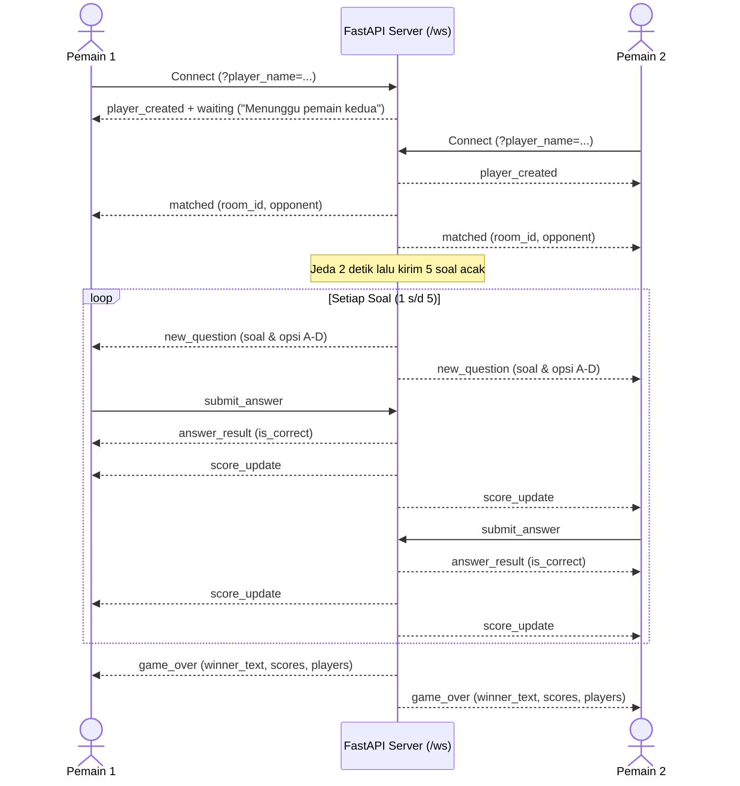

<div align="center">

# ⚡ Kuwizz — Multiplayer Quiz

**Beat your friends in your field.**

Aplikasi kuis **multiplayer 1v1 real-time** berbasis web yang mempertemukan dua pemain secara otomatis melalui WebSocket, lengkap dengan papan skor langsung, pengatur waktu pertandingan, umpan balik jawaban instan, serta log aktivitas koneksi.

<p>
  
  
  
  
</p>

<p>
  <a href="#-tentang-aplikasi">Tentang</a> •
  <a href="#-fitur-utama">Fitur</a> •
  <a href="#%EF%B8%8F-alur-permainan">Alur Permainan</a> •
  <a href="#-struktur-proyek">Struktur Proyek</a> •
  <a href="#-cara-menjalankan">Cara Menjalankan</a> •
  <a href="#-protokol-websocket">Protokol WebSocket</a>
</p>

</div>

---

## 📖 Tentang Aplikasi

**Kuwizz** adalah platform duel kuis interaktif dua pemain yang berjalan secara *real-time* di browser. Pemain cukup memasukkan nama panggilan pada halaman lobi, menekan tombol **Connect**, dan sistem *matchmaking* di server akan otomatis memasangkan pemain dengan lawan yang sedang menunggu.

Begitu ruangan (*room*) terbentuk, kedua pemain akan bertanding menjawab **5 soal pilihan ganda** yang dipilih secara acak dari bank soal. Skor diperbarui secara langsung setiap kali jawaban dikirim, dan pemenang ditentukan di akhir pertandingan berdasarkan total poin tertinggi.

---

## ✨ Fitur Utama

| Fitur | Deskripsi |
| :--- | :--- |
| 🎯 **Auto Matchmaking 1v1** | Antrean otomatis berbasis `asyncio.Lock` yang langsung memasangkan dua pemain ke dalam satu *game room*. |
| ⚡ **Komunikasi Real-Time (WebSocket)** | Pertukaran event antara klien dan server melalui endpoint `/ws` tanpa perlu *refresh* halaman. |
| 🏆 **Live HUD & Sistem Skor** | Menampilkan skor Anda vs lawan secara *real-time* (**+100 poin** per jawaban benar) serta *timer* durasi pertandingan. |
| 💡 **Umpan Balik Jawaban Instan** | Opsi jawaban langsung menandai status benar atau kurang tepat sesaat setelah pemain memilih. |
| 🔄 **Rekoneksi Sesi & Penanganan Putus Koneksi** | Mendukung `player_id` & `session_token` untuk menyambung kembali sesi, serta notifikasi otomatis jika lawan keluar (`opponent_left`). |
| 📊 **Papan Hasil & Main Lagi** | Ringkasan akhir pertandingan (Menang/Kalah/Seri, skor akhir, durasi) dengan tombol **Cari lawan lagi** langsung dari layar hasil. |
| 🪵 **Server Status & Activity Log** | Panel pemantauan status server dan riwayat event koneksi pada halaman utama. |

---

## ⚙️ Alur Permainan



---

## 🛠️ Teknologi yang Digunakan

- **Backend:** Python, [FastAPI](https://fastapi.tiangolo.com/), [Uvicorn](https://www.uvicorn.org/), WebSockets, `asyncio`
- **Frontend:** Semantic HTML5 (dengan sistem *partials*), Modular CSS3, Vanilla ES Modules (`frontend/js/`)
- **Layanan Statis:** Frontend dilayani langsung oleh FastAPI melalui `StaticFiles` di root `/`

---

## 📂 Struktur Proyek

```text
multiplayer-quiz/
├── backend/
│   ├── main.py                  # Entry point FastAPI, endpoint /health, & static mount "/"
│   ├── requirements.txt         # Dependensi Python (fastapi, uvicorn)
│   └── app/
│       ├── matchmaking.py       # Router WebSocket (/ws) & loop penerimaan pesan JSON
│       ├── quiz_questions.py    # Kumpulan definisi soal kuis
│       ├── room_manager.py      # Re-export RoomManager
│       ├── questions/           # Bank soal modular (bank_a.py, bank_b.py, bank_c.py, types.py)
│       └── rooms/               # Manajemen room & state permainan
│           ├── manager.py       # Kelas RoomManager (players, rooms, queue, lock)
│           ├── models.py        # Dataclass PlayerSession & GameRoom
│           ├── connect.py       # Pembuatan sesi pemain baru
│           ├── resume.py        # Logika rekoneksi sesi menggunakan session_token
│           ├── queue.py         # Antrean matchmaking & pembukaan room 1v1
│           ├── messages.py      # Dispatcher aksi klien (find_match, submit_answer)
│           ├── answers.py       # Penanganan pengiriman jawaban & update skor
│           ├── answer_check.py  # Validasi & penilaian jawaban (+100 poin)
│           ├── game_question.py # Pengiriman soal & broadcast score_update
│           ├── game_advance.py  # Transisi antar soal & penentuan pemenang (game_over)
│           ├── disconnect.py    # Pembersihan room & notifikasi lawan terputus
│           └── send.py          # Helper pengiriman & broadcast pesan WebSocket
└── frontend/
    ├── index.html               # Halaman utama (Lobby & Quiz Screen)
    ├── partials/                # Potongan HTML modular (hero, players, status, log)
    ├── css/                     # Stylesheet modular (layout, hero, quiz, status, responsive)
    ├── js/                      # Logika klien modular (WebSocket, state, HUD, view renderer)
    └── src/                     # Komponen & konfigurasi Vite/React/TypeScript tambahan
```

---

## 🚀 Cara Menjalankan

### Prasyarat
- **Python 3.10+** (disarankan Python 3.11 atau lebih baru)
- `pip`

### 1. Clone Repositori
```bash
git clone https://github.com/aliefalghifari/multiplayer-quiz.git
cd multiplayer-quiz
```

### 2. Buat Virtual Environment & Install Dependensi
```bash
cd backend
python -m venv .venv
```

Aktifkan virtual environment:
- **Windows (PowerShell):**
  ```powershell
  .\.venv\Scripts\Activate.ps1
  ```
- **macOS / Linux:**
  ```bash
  source .venv/bin/activate
  ```

Install paket yang dibutuhkan:
```bash
pip install -r requirements.txt
```

### 3. Jalankan Server
Dari dalam folder `backend/`:
```bash
uvicorn main:app --reload
```

Server akan berjalan di **`http://127.0.0.1:8000`**.
- Aplikasi web: `http://127.0.0.1:8000/`
- Health check API: `http://127.0.0.1:8000/health`

### 4. Uji Bermain 1v1 Secara Lokal
1. Buka `http://127.0.0.1:8000/` di **Tab Browser 1**, masukkan nama pemain pertama, lalu klik **Connect**.
2. Buka `http://127.0.0.1:8000/` di **Tab Browser 2**, masukkan nama pemain kedua, lalu klik **Connect**.
3. Kedua pemain akan otomatis dipasangkan dan pertandingan kuis dimulai dalam 2 detik!

---

## 📡 Protokol WebSocket

Koneksi dibuka ke:
```text
ws://127.0.0.1:8000/ws?player_name=<NamaPemain>
```
*(Untuk menyambung kembali sesi yang ada, klien dapat menyertakan parameter `player_id` dan `session_token`.)*

### Aksi dari Klien → Server
| `action` | Payload | Keterangan |
| :--- | :--- | :--- |
| `find_match` | `{ "action": "find_match" }` | Memasukkan pemain kembali ke antrean matchmaking. |
| `submit_answer` | `{ "action": "submit_answer", "room_id": "...", "question_index": 0, "answer_index": 1 }` | Mengirim indeks pilihan jawaban (`0`–`3`) untuk soal aktif. |

### Event dari Server → Klien
| `type` | Keterangan |
| :--- | :--- |
| `player_created` | Sesi pemain berhasil dibuat beserta `player_id` dan `session_token`. |
| `waiting` | Pemain masuk ke antrean menunggu lawan kedua. |
| `matched` | Lawan ditemukan; menyertakan `room_id` dan nama `opponent`. |
| `new_question` | Mengirim teks soal, daftar `options`, `question_index`, dan `total_questions`. |
| `answer_result` | Memberi tahu klien apakah jawabannya benar (`is_correct: true/false`). |
| `score_update` | Pembaruan skor dan daftar pemain di dalam room. |
| `game_over` | Pertandingan selesai beserta `winner_text` dan skor akhir. |
| `opponent_left` | Lawan terputus dari server dan room ditutup. |
| `reconnected` / `player_reconnected` | Konfirmasi bahwa pemain berhasil menyambung kembali ke sesi. |
| `error` | Informasi validasi atau kesalahan pesan. |

---

## 🧩 Menambah Bank Soal

Saat ini bank soal berada di direktori `backend/app/questions/` (`bank_a.py`, `bank_b.py`, `bank_c.py`) yang digabungkan di `backend/app/questions/__init__.py` (total 15 soal bertema penalaran dan tata bahasa/kata baku Bahasa Indonesia, dan 5 soal diambil secara acak di setiap pertandingan).

Untuk menambah soal baru, cukup tambahkan entri bertipe `QuizQuestion` ke salah satu bank soal:

```python
{
    "question": "Pertanyaan kuis Anda di sini?",
    "options": ["Pilihan A", "Pilihan B", "Pilihan C", "Pilihan D"],
    "answer": 0,  # Indeks jawaban benar (0 = A, 1 = B, 2 = C, 3 = D)
}
```

---

<div align="center">

Dibuat dengan ❤️ oleh **[Alief Alghifari](https://github.com/aliefalghifari)**

</div>
